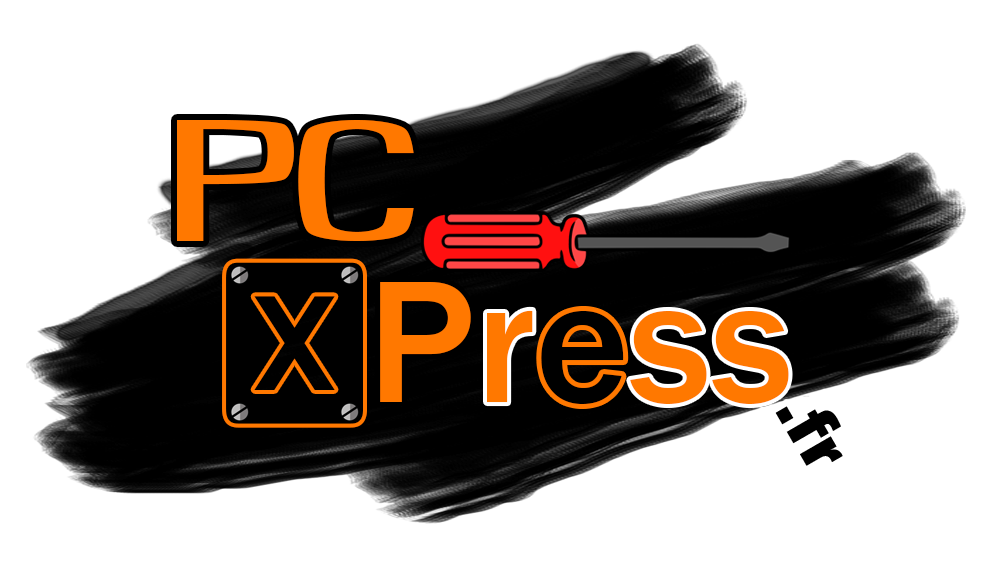

<p align="center"></p>

# ircxp — all the features

**ircxp** is an all-in-one IRC server written in Go by [PcXpress](https://pcxpress.fr): server, services (NickServ, ChanServ, OperServ, BotServ, HostServ, FunServ), web client, built-in bouncer, Android app, AI-assisted moderation and administration panel — in **a single binary**, with no dependency to install.

*Français : [FEATURES.md](FEATURES.md)*

This repository distributes the **demo version**: all the features, limited to **10 connections** and without server links. Enough to try everything at home before buying.

- Online demo: https://ircxp.live (IRC: `ircxp.live`, TLS 6697 / 6667)
- Shop and licences: https://shop.ircxp.live
- Documentation: https://ircxp.live/wiki (English version: button “EN”)

> Current version: **2.2.1**. See the [Releases](../../releases).

## Online demo

**Try ircxp without installing anything: <https://ircxp.live>**

This server is a real ircxp server, the **HUB** of a small network run by PcXpress, open for testing:

| | |
|---|---|
| **Web client** | <https://ircxp.live>: pick a nickname and go, nothing to install |
| **IRC server** | `irc.ircxp.live`: port `6697` (TLS, valid Let's Encrypt certificate) or `6667` (plain), with mIRC, HexChat, irssi… |
| **Wiki** | <https://ircxp.live/wiki>: commands, services, channel modes (the interface and the wiki have an English version: button “EN”) |

To discover it: create an account (`/ns REGISTER <password>`), register a channel (`/cs REGISTER #mychannel`), set its access list and options,
try instant translation (`/lang`, `/translate on`), the channel modes (`+Z` word filter, `+T` translation bot, `+H` history, `+M` moderation, `+E` end-to-end encryption, `+R`) or the `!motus` game (if enabled).
The **administration panel** (`/admin`) is protected and not open to the public.
This is a demonstration server: it can be restarted or reset at any time, do not put anything important on it.

## Features

| | |
|---|---|
| **IRC** | TCP + TLS, WebSocket, SASL (PLAIN, EXTERNAL), channel modes (including `+R`, `+Z`, `+E`), cloaks, network bans |
| **IRCv3** | capability negotiation 3.2 (`CAP LS 302`, `REQ`/`ACK`/`NAK`, `LIST`, `cap-notify`, values and multi-line lists) with `multi-prefix`, `away-notify`, `account-notify`, `extended-join`, `chghost`, `server-time`, `sasl`, `echo-message`, `batch` and `draft/chathistory` (`CHATHISTORY` on `+H` channels) |
| **End-to-end encrypted channels** | channel mode `+E`: messages are encrypted in the web client (AES-256-GCM, key derived from a channel passphrase that the server never sees); only those channels are encrypted |
| **Client certificate** | identification by SHA-256 fingerprint (`NickServ CERT`, SASL EXTERNAL) |
| **Registered channels** | ChanServ: access list, `AUTOOP`, `AUTOVOICE`, kept topic, locked modes, welcome message |
| **Word filter** | channel mode `+Z`, list set in the panel |
| **Network identity** | name, coloured MOTD and ASCII logo, renamable services, `#services` channel, connection statistics (`/LUSERS`) and `/ADMIN` info |
| **Quiz** | question and answer game with timer, effects, leaderboard, sentence answers (keywords) and file import |
| **Motus** | the hidden-word game: length and first letter given, attempts shared by the channel, coloured feedback 🟥🟡🟦, leaderboard and word-list import |
| **Ranks and XP** | the more you talk, the more XP and ranks you get: announcements, `!rank`, leaderboard, WHOIS line |
| **SQLite database and backups** | a single database, verified automatic backups, download and restore from the panel |
| **Avatars** | avatars of accounts (approved by an administrator) and of Discord / Fluxer users |
| **Companion** | small animated cat in the web client (off by default, can be turned on by the administrator) |
| **Translation** | instant translation of messages, per person: everybody writes and reads in his language; in a multilingual channel, mode `+T` adds a **translation bot** configurable in the panel |
| **Bouncer** | built-in ZNC-style bouncer: always-online session, missed messages replayed, several clients, external IRC networks (also usable from the web client), automatic attachment, port range and user panel `/bnc` |
| **History** | channel history replayed on join and catch-up of missed messages (mode `+H`, `/HISTORY`) |
| **Useful bots** | reminders and notes (`!remind`, `!note`), monitoring of sites and services with alerts, anti-spam and AI moderation (mode `+M`) |
| **Legal** | privacy, terms and minimum age pages, abuse reporting (`/REPORT`), GDPR register |
| **Operators** | levels helper / ircop / admin / netadmin / devadmin, **per-operator panel access**, tabs and actions by level, **connection log** (who connects and quits, with the IP, mode `+c` and panel tab, with a limited retention) |
| **Services** | NickServ, ChanServ, OperServ, BotServ, HostServ, FunServ, FiGoLu bot (“darkbot”: welcome, sentences, answers) |
| **Web client** | private messages, mentions, autocomplete, history, nickname effects, mobile, theme, watermark, **English / French interface** |
| **Admin panel** | complete management in tabs (`/admin`), built-in wiki (`/wiki`) |
| **Bridges** | Discord and Fluxer ↔ IRC, and IRC ↔ IRC (another network such as Libera): instant messages, remote statuses mirrored, the bots answer on both sides |
| **Security** | SecureServ (DNSBL, per-IP limits), anti-takeover, password failure lockout |
| **Help** | HelpServ and the `HELP` of every service: one function per line, in French or English |
| **Anonymity and IPv6** | Tor service (`.onion` address in addition to the normal one) and IPv6 TLS port, turned on from the panel |
| **Network** | HUB / LEAF, TLS links with pinned fingerprint |

> All these features are in the demo version; only the limits in the “Demo and full licence” table differ.

## Demo and full licence

| | Demo (this repository) | Network licence |
|---|---|---|
| Connections | 10 at most | unlimited |
| Server links (hub / leaf) | no | yes |
| Updates and support | no | yes |

The full licence can be ordered on https://shop.ircxp.live.

## Download

Go to the **[Releases](../../releases)** and take the archive for your system:

| System | Archive |
|---|---|
| Linux 64-bit | `ircxp-demo-vX.Y.Z-linux-amd64.tar.gz` |
| Linux ARM64 | `ircxp-demo-vX.Y.Z-linux-arm64.tar.gz` |
| Raspberry Pi (ARMv7) | `ircxp-demo-vX.Y.Z-linux-armv7.tar.gz` |
| Windows 64-bit | `ircxp-demo-vX.Y.Z-windows-amd64.zip` |
| Windows ARM64 | `ircxp-demo-vX.Y.Z-windows-arm64.zip` |
| macOS Apple Silicon | `ircxp-demo-vX.Y.Z-darwin-arm64.tar.gz` |
| macOS Intel | `ircxp-demo-vX.Y.Z-darwin-amd64.tar.gz` |

Each release has a `SHA256SUMS` file to check the download:

```sh
sha256sum -c SHA256SUMS --ignore-missing
```

## Quick install (Linux)

```sh
tar xzf ircxp-demo-v*-linux-amd64.tar.gz
cd ircxp-demo-v*-linux-amd64
cp config.example.json config.json   # then adapt the server name
./ircxp
```

The server listens for IRC on ports 6667 (plain) and 6697 (TLS), and opens the web client and the administration panel. The archive contains the complete documentation in `docs/` (in French: installation, configuration, services, bouncer, moderation…) and an `ircxp.service` file for systemd.

## Resources and deployment

Measured on ircxp (a single Go process): **14 MB of RAM at start**, about 50 KB per connection (2,000 simultaneous connections ≈ 107 MB), negligible CPU.
**Recommended: 1 vCPU, 256 MB of RAM, 1 GB of disk** (minimum: 128 MB, 200 MB).

ircxp works very well:
- with a **dedicated IP** (IRC and web ports directly exposed);
- **behind NPMPlus** (or nginx / Caddy) for the web over HTTPS: quick tutorial;
- in an **LXC** container (Proxmox): this is the demo setup.

## Inspirations and references

ircxp is an independent project, **written from scratch in Go**: it reuses the code of none of the projects below, which are cited as sources of inspiration and documentation.

- **Webmaster Conferenceroom**: the application of the time, now abandonware, which gave the wish for this project (web chat + IRC all in one). Original page, archived: <https://web.archive.org/web/20160319202230/http://webmaster.com/cr.htm>.
- **Darkbot**: the FiGoLu bot takes the spirit of Darkbot (automatic answers, random sentences, variables in messages). Command documentation: <https://darkbot.sourceforge.net/com_all.htm>.
- **Anope**: the services (NickServ, ChanServ, BotServ, HostServ, OperServ…), their commands and logic are inspired by Anope. Site: <https://www.anope.org/>.
- **UnrealIRCd**: the IRC server is inspired by UnrealIRCd for its modes (user and channel), its operator commands (`KILL`, `SAJOIN`, `SAPART`, `SHUN`, `GLINE`, `KLINE`, `ZLINE`, `WALLOPS`…) and address masking. Site: <https://www.unrealircd.org/>.

The names of these projects belong to their respective authors; ircxp is neither affiliated with nor endorsed by them.

**Word list for Motus**: [an-array-of-french-words](https://github.com/words/an-array-of-french-words) (Zeke Sikelianos, MIT licence, about 336,000 French words derived from the Letterpress game list).

## About

ircxp is created and hosted by **PcXpress**: <https://pcxpress.fr>.

> I have been a DevOps engineer since 2021 and I love tinkering: building servers and containers, automating, taking everything apart to rebuild it better.
> ircxp was born from this wish to fit everything in a single program, simple to install and to evolve; it runs on my own homelab.
>
> I am modern: I use Claude, Anthropic's AI, and it makes everything so much simpler. It writes, tests and documents with me, and I keep control of the choices, the tests and the release.

## Licence

The demo version is provided **free of charge for evaluation**. Its redistribution and commercial use are forbidden without a licence. The source code is not provided. See [LICENSE.en.md](LICENSE.en.md) (English) and [LICENSE.md](LICENSE.md) (French, the reference text).

## Contact

Questions, quotes, support: **support@ircxp.live**, or on IRC: https://ircxp.live.

Created and hosted by [PcXpress](https://pcxpress.fr).
