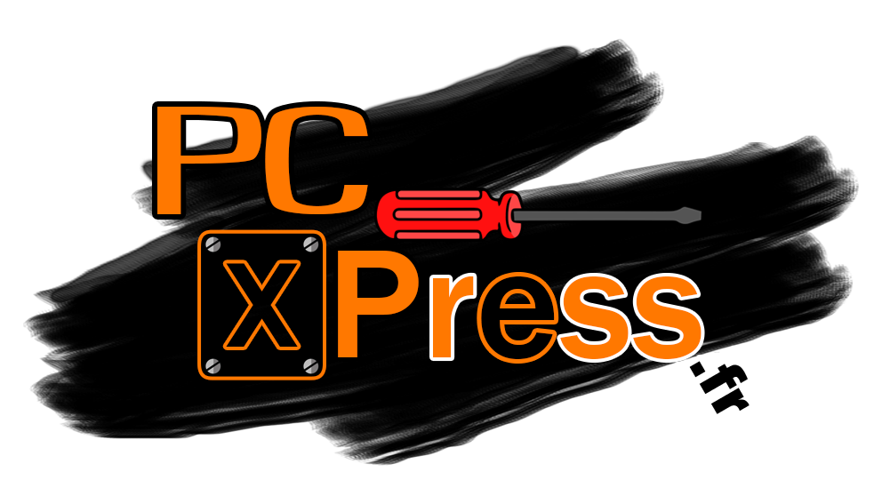

<p align="center"></p>

# ircxp — toutes les fonctions

**ircxp** est un serveur IRC tout-en-un écrit en Go par [PcXpress](https://pcxpress.fr) : serveur, services (NickServ, ChanServ, OperServ, BotServ, HostServ, FunServ), client web, bouncer intégré, application Android, modération assistée par IA, panel d'administration — dans **un seul binaire**, sans dépendance à installer.

*English : [FEATURES.en.md](FEATURES.en.md)*

Ce dépôt distribue la **version de démonstration** : toutes les fonctions, limitée à **10 connexions** et sans liaison entre serveurs. De quoi tout essayer chez vous avant d'acheter.

- Démo en ligne : https://ircxp.live (IRC : `ircxp.live`, TLS 6697 / 6667)
- Boutique et licences : https://shop.ircxp.live
- Documentation : https://ircxp.live/wiki (version anglaise : bouton « EN »)

> Version actuelle : **2.3.0**. Voir les [Releases](../../releases).

## Démo en ligne

**Essaie ircxp sans rien installer : <https://ircxp.live>**

Ce serveur est un vrai serveur ircxp, le **HUB** d'un petit réseau tenu par PcXpress, ouvert pour tester :

| | |
|---|---|
| **Client web** | <https://ircxp.live> : choisis un pseudo et c'est parti, rien à installer |
| **Serveur IRC** | `irc.ircxp.live` : port `6697` (TLS, certificat Let's Encrypt valide) ou `6667` (clair), avec mIRC, HexChat, irssi… |
| **Wiki** | <https://ircxp.live/wiki> : commandes, services, modes de salon |

Pour découvrir : crée un compte (`/ns REGISTER <mot de passe>`), enregistre un salon (`/cs REGISTER #monsalon`), règle sa liste d'accès et ses options,
essaie la traduction instantanée (`/lang`, `/translate on`), les modes de salon (`+Z` filtre de mots, `+T` traduction par bot, `+H` historique, `+M` modération, `+R`) ou le jeu `!motus` (s'il est activé).
Le **panel d'administration** (`/admin`) est protégé et n'est pas ouvert au public ; des captures d'écran sont prévues plus bas.
C'est un serveur de démonstration : il peut être redémarré ou remis à zéro à tout moment, n'y mets rien d'important.

## Fonctionnalités

| | |
|---|---|
| **IRC** | TCP + TLS, WebSocket, SASL (PLAIN, EXTERNAL), modes de salon (dont `+R`, `+Z` et `+E`), cloaks, bans réseau |
| **IRCv3** | négociation des capacités 3.2 (`CAP LS 302`, `REQ`/`ACK`/`NAK`, `LIST`, `cap-notify`, valeurs, listes en plusieurs lignes) avec `multi-prefix`, `away-notify`, `account-notify`, `extended-join`, `chghost`, `server-time`, `sasl`, `echo-message`, `batch` et `draft/chathistory` |
| **Salons chiffrés de bout en bout** | mode `+E` : messages chiffrés dans le client web (AES-256-GCM, phrase secrète du salon que le serveur ne connaît jamais), seuls ces salons sont chiffrés |
| **Certificat client** | identification par empreinte SHA-256 (`NickServ CERT`, SASL EXTERNAL) |
| **Salons enregistrés** | ChanServ : liste d'accès, `AUTOOP`, `AUTOVOICE`, sujet conservé, modes verrouillés, message d'accueil |
| **Filtre de mots** | mode de salon `+Z`, liste réglée dans le panel |
| **Identité du réseau** | nom, MOTD en couleurs et logo ASCII, services renommables, salon `#services`, statistiques de connexion (`/LUSERS`) et infos `/ADMIN` |
| **Quiz** | jeu de questions-réponses avec minuteur, effets, classement, réponses en phrases (mots-clés) et import de fichiers |
| **Motus** | le jeu du mot caché : longueur et première lettre données, essais communs au salon, retour coloré 🟥🟡🟦, classement et import de listes de mots |
| **Rangs et XP** | plus on parle, plus on gagne d'XP et de rangs : annonces, `!rang`, classement, ligne dans le WHOIS |
| **Base SQLite et sauvegardes** | une seule base, sauvegardes automatiques vérifiées, téléchargement et restauration depuis le panel |
| **Avatars** | avatars des comptes (validés par un administrateur) et des utilisateurs Discord / Fluxer |
| **Compagnon** | petit chat animé dans le client web (désactivé par défaut, activable par l'administrateur) |
| **Traduction** | traduction instantanée des messages, par personne : chacun écrit et lit dans sa langue ; en salon multilingue, le mode `+T` ajoute un **bot de traduction** réglable dans le panel |
| **Bouncer** | bouncer intégré façon ZNC : session toujours en ligne, messages manqués rejoués, plusieurs clients, réseaux IRC externes (utilisables aussi depuis le client web), rattachement automatique, plage de ports et panel utilisateur `/bnc` |
| **Historique** | historique des salons rejoué à l'arrivée et rattrapage des messages manqués (mode `+H`, `/HISTORY`) |
| **Bots utiles** | rappels et notes (`!remind`, `!note`), supervision de sites et services avec alertes, modération anti-spam et IA (mode `+M`) |
| **Légal** | pages de confidentialité, conditions et âge minimum, signalement d'abus (`/REPORT`), registre RGPD |
| **Opérateurs** | niveaux helper / ircop / admin / netadmin / devadmin, **accès au panel par opérateur** (case cochée par un netadmin ou un devadmin), onglets et actions selon le niveau, **journal des connexions** (qui se connecte et part, avec l'IP, mode `+c` et onglet du panel, conservation limitée) |
| **Services** | NickServ, ChanServ, OperServ, BotServ, HostServ, FunServ, bot FiGoLu (« darkbot » : bienvenue, phrases, réponses) |
| **Client web** | messages privés, mentions, autocomplétion, historique, effets de pseudo, mobile, thème, filigrane, **interface en français et en anglais** |
| **Panel admin** | gestion complète en onglets (`/admin`), wiki intégré (`/wiki`) |
| **Ponts** | Discord et Fluxer ↔ IRC, et IRC ↔ IRC (un autre réseau comme Libera) : messages instantanés, statuts distants reportés, les bots répondent des deux côtés |
| **Sécurité** | SecureServ (DNSBL, limites par IP), anti-takeover, verrouillage des échecs de mot de passe |
| **Aide** | HelpServ et `HELP` de chaque service : une fonction par ligne, en français ou en anglais |
| **Anonymat et IPv6** | service Tor (adresse `.onion` en plus de l'adresse normale) et port TLS IPv6, activables dans le panel |
| **Réseau** | HUB / LEAF, liens TLS avec empreinte épinglée |

> Toutes ces fonctions sont dans la version de démonstration ; seules les limites du tableau « Démo et licence complète » changent.

## Démo et licence complète

| | Démo (ce dépôt) | Licence réseau |
|---|---|---|
| Connexions | 10 au plus | illimitées |
| Liaison entre serveurs (hub / leaf) | non | oui |
| Mises à jour et assistance | non | oui |

La licence complète se commande sur https://shop.ircxp.live.

## Installation rapide (Linux)

```sh
tar xzf ircxp-demo-v*-linux-amd64.tar.gz
cd ircxp-demo-v*-linux-amd64
cp config.example.json config.json   # puis adaptez le nom du serveur
./ircxp
```

Le serveur écoute en IRC sur les ports 6667 (clair) et 6697 (TLS), et ouvre le client web et le panel d'administration. L'archive contient la documentation complète dans `docs/` (installation, configuration, services, bouncer, modération…) et un fichier `ircxp.service` pour systemd.

## Ressources et déploiement

Mesuré sur ircxp (un seul processus Go) : **14 Mo de RAM au démarrage**, environ 50 Ko par connexion (2 000 connexions simultanées ≈ 107 Mo), CPU négligeable.
**Recommandé : 1 vCPU, 256 Mo de RAM, 1 Go de disque** (minimum : 128 Mo, 200 Mo). Détails : docs/INSTALL.md.

ircxp fonctionne très bien :
- avec une **IP dédiée** (ports IRC et web directement exposés) ;
- **derrière NPMPlus** (ou nginx / Caddy) pour le web en HTTPS : tutoriel rapide ;
- dans un conteneur **LXC** (Proxmox) : c'est la configuration de la démo.

## Inspirations et références

ircxp est un projet indépendant, **écrit de zéro en Go** : il ne reprend le code d'aucun des projets ci-dessous, qui sont cités comme sources d'inspiration et de documentation.

- **Webmaster Conferenceroom** : l'application de l'époque, tombée dans l'abandonware, qui a donné l'envie de ce projet (chat web + IRC tout-en-un).
  Page d'origine, archivée : <https://web.archive.org/web/20160319202230/http://webmaster.com/cr.htm>.
  La discussion Reddit qui m'a convaincu : <https://www.reddit.com/r/irc/comments/qbz1wh/webmaster_conferenceroom/>.
- **Darkbot** : le bot FiGoLu reprend l'esprit de Darkbot (réponses automatiques, phrases aléatoires, variables dans les messages). Documentation des commandes : <https://darkbot.sourceforge.net/com_all.htm>.
- **Anope** : les services (NickServ, ChanServ, BotServ, HostServ, OperServ…), leurs commandes et leur logique s'inspirent d'Anope. Site : <https://www.anope.org/>.
- **UnrealIRCd** : le serveur IRC s'inspire d'UnrealIRCd pour ses modes (utilisateur et salon), ses commandes d'opérateur (`KILL`, `SAJOIN`, `SAPART`, `SHUN`, `GLINE`, `KLINE`, `ZLINE`, `WALLOPS`…) et le masquage des adresses. Site : <https://www.unrealircd.org/>.

Les noms de ces projets appartiennent à leurs auteurs respectifs ; ircxp n'est ni affilié à eux ni approuvé par eux.

**Liste de mots pour Motus** : [an-array-of-french-words](https://github.com/words/an-array-of-french-words) (Zeke Sikelianos, licence MIT, environ 336 000 mots français dérivés de la liste du jeu Letterpress). Le fichier [`index.json`](https://raw.githubusercontent.com/words/an-array-of-french-words/refs/heads/master/index.json) s'importe tel quel dans l'onglet Motus du panel (bouton « Importer le fichier », 10 Mo maximum). Seuls les mots de 4 à 15 lettres sans tiret ni apostrophe sont gardés.

## À propos

ircxp est créé et hébergé par **PcXpress** : <https://pcxpress.fr>.

> Je suis DevOps depuis 2021 et j'adore bidouiller : monter des serveurs, des conteneurs, automatiser, tout démonter pour mieux le reconstruire.
> ircxp est né de cette envie de tout faire tenir dans un seul programme, simple à installer et à faire évoluer ; il tourne sur mon propre homelab.
>
> Je suis moderne : je m'aide de Claude, l'IA d'Anthropic, et ça simplifie tellement tout. Elle écrit, teste et documente avec moi, et je garde la main sur les choix, les essais et la mise en ligne.

## Licence

La version de démonstration est fournie **gratuitement pour évaluation**. Sa redistribution et son usage commercial sont interdits sans licence. Le code source n'est pas fourni. Voir [LICENSE.md](LICENSE.md) (texte de référence, en français) et [LICENSE.en.md](LICENSE.en.md) (traduction anglaise).

## Contact

Questions, devis, assistance : **support@ircxp.live**, ou sur IRC : https://ircxp.live.

Créé et hébergé par [PcXpress](https://pcxpress.fr).
